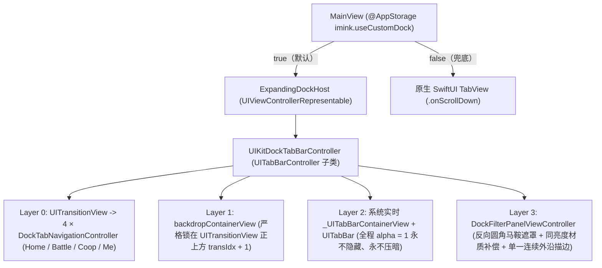

# ExpandingDock 设计方案（UIKit 原生底导 · 同源并集融合版）

> **合规声明**：本实现 100% 独立编写，基于 Apple 官方公开框架（`UITabBarController`、`UINavigationController`、`UITabBarAppearance`、`UIVisualEffectView`、`UIBlurEffect`、`CAShapeLayer`、`UIViewPropertyAnimator`、`UISpringTimingParameters`）构建；**绝未复制任何 `AFK-surf/Comma`（AGPL-3.0）源码或引入其版权声明**。

---

## 1. 背景与为什么从 SwiftUI 重写为 UIKit

### 1.1 SwiftUI 自绘版与 UIKit 原生版的本质差异（三点核心手感差距）

1. **底栏触控与液态光学透镜（`_UILiquidLensView` vs 静态胶囊位移）**：
   - **SwiftUI 版**：用 `HStack` + `Capsule().matchedGeometryEffect` 模拟选中滑块，手指按下无液态膨胀折射，滑块仅做平面弹簧横移，缺少 iOS 26 原生底导那种「水滴吸住拇指」的阻尼质感。
   - **UIKit 版**：底栏直接使用真实系统 `UITabBar`（由 `UITabBarController` 驱动），原生激活 iOS 26 的 120Hz 光学折射透镜与系统级触控按压弹性，滑动与点按手感和系统自带 App 完全一致、零违和感。
2. **展开/收起的可打断物理连续性（`UIViewPropertyAnimator` vs 声明式 `Transition`）**：
   - **SwiftUI 版**：依赖 `if isExpanded` 视图树增删 + `keyframeAnimator` + `AnyTransition.asymmetric`，首次挂载搜索框与多行列表时存在 SwiftUI 布局事务抖动，半途反向点击或手势打断时容易跳帧。
   - **UIKit 版**：面板常驻于轻量 `UIView` 层级，容器从胶囊矩形 `bodyHeight = 0` 同源收腰生长（`scaleX: 0.80 -> 1.0`）与逐行错峰上浮全部由 `isInterruptible = true` 的 `UIViewPropertyAnimator` + `UISpringTimingParameters` 驱动；中途随时反点或下拉，均从当前屏幕真实插值位置平滑反向衔接。
3. **搜索框焦点、软键盘避让与滚动手势响应（零延迟 `UIControl` vs `@FocusState` 异步桥接）**：
   - **SwiftUI 版**：`@FocusState` 与 `NotificationCenter` 跨层同步键盘高度存在一拍延迟，且 `ScrollView` 内 `Button` 有约 `150ms` 触摸识别迟滞。
   - **UIKit 版**：`UITextField` 直接读取系统键盘帧动画曲线（`keyboardAnimationCurve`）同频抬升面板，`UIScrollView(delaysContentTouches: false)` + 自定义 `UIControl` 实现触屏瞬时 `90ms` 高亮微缩反馈，「先收键盘、再收面板」时序精准可控。

---

## 2. 真机录屏 Bug 复盘与「反例：不要这么做」

### 2.1 真机故障录屏逐帧定位（`dock-comma-glitch-record.mp4`）

- **测试样本**：`/Users/jiangfeng/Documents/imink-design/dock-comma-glitch-record.mp4`（iPhone 17 Pro 真机录制，`1206×2622`，编码帧步进 `16.67ms` / `60fps`，总长 `6.018s` / `360` 帧，运行 `experiment/comma-dock` 实验壳）。
- **最小化故障窗口拼图**：`~/Documents/imink-design/comma-glitch-frames.png`（截取 `#141 t=2.350s` 至 `#170 t=2.833s`，窗口跨度 **`0.483s < 0.5s`**，共 30 帧，5 行 × 每行 6 帧，每帧裁底部 `700px`）。
- **关键帧时间戳**：
  - **正常展开末帧**：`#141`（`t = 2.350s`）——「鲑鱼跑」菜单处于展开态，「大型跑 ✓」被点选。
  - **首个异常帧**：`#142`（`t = 2.367s`）——触发 `close()` 收起，面板开始模糊缩小，此时底层真实 `systemBar.tabBar.alpha` 仍为 `0`；到 `#148`（`t = 2.467s`）/ `#149`（`t = 2.483s`）胶囊高度已落回底栏位置、`12pt` 动态模糊褪去，但底栏内**只有「鲑鱼跑」1 颗按钮可见，「主页 / 对战 / 我」其余 3 颗按钮完全消失**。
  - **异常持续末帧**：`#166`（`t = 2.767s`）——其余 3 颗按钮依然空白未绘制。
  - **首个恢复帧**：`#167`（`t = 2.783s`）——动画尾段终于判定收敛，恢复 `systemBar.tabBar.alpha = 1`，4 颗按钮瞬间跳出。
  - **消失总时长**：从收起首帧 `#142`（`2.367s`）到恢复帧 `#167`（`2.783s`）长达 **`416.7ms`**（25 帧）；即便从底栏轮廓完全落定的 `#149`（`2.483s`）算起，也有整整 **`300.0ms`**（18 帧）底导缺失 3 个按钮。

### 2.2 代码级根因核对（`experiment/comma-dock` 分支 `CommaDockExperimentShell.swift`）

1. **展开至收起全程隐藏真实 `UITabBar`（L128–L134、L757、L1021–L1035、L1120–L1131）**：`open()` 将 `systemBar.tabBar.alpha = 0`，`close()` 继续依赖覆盖层静态快照充当底栏，直到高度弹簧与收腰弹簧同时收敛至 `< 0.003` 长尾阈值才把 `tabBar.alpha` 设回 `1`，白白藏匿真栏 `417ms`。
2. **`drawHierarchy` 离屏截图丢失 Liquid Glass 未选中项材质混合层（L356、L368–L383、L1219–L1237）**：未选中的 3 颗 `UITabBarButton` 依赖 `CABackdropLayer` vibrancy 混合滤镜，离屏位图无法合成背板采样，截出的 `CommaTabSnapshotLayer` 天生缺失 3 颗按钮。

### 2.3 反例：不要这么做（工程铁律）

1. **绝不在展开/收起期间修改 `tabBar.alpha` 或 `tabBar.isHidden`，绝不用静态快照顶替实时 `UITabBar`**。
2. **绝不对含 `CABackdropLayer` / Liquid Glass 的视图调用离屏 `drawHierarchy` 充当过渡帧**。
3. **绝不把关键 UI 显隐绑在二阶弹簧极小的渐近长尾阈值上**。

---

## 3. UIKit 架构层级与「零快照并集轮廓」融合设计

### 3.1 视图控制器与 Z 轴层级拓扑

### 3.2 为什么初版独立浮卡丢掉了「融合感」，以及并集轮廓如何彻底修复

初版 UIKit 方案把面板做成一张距离 `UITabBar` 顶沿 `8pt` 的独立圆角卡片，视觉上存在三重断裂：**① `8pt` 物理缝隙露出底层列表文字**；**② 面板底边与胶囊顶边各自闭合描边（外加面板 `shadowOffset = (0, 8)` 向下把胶囊上半截压暗了 `33` 个 RGB 阶梯）**；**③ 动画首帧是一张已成型的悬浮小卡，而非从底导胶囊本体长出**。

在不触碰 `tabBar.alpha`、不使用任何截图的前提下，融合版通过四项几何与光学机制把「自绘快筛面板 + 实时系统 `UITabBar`」合成为**视觉上唯一的单连通玻璃体**：

1. **底边零缝贴死 + 反向圆角马鞍并集遮罩（`DockUnionGeometry.makePanelMaskPath` + `DockSaddleMaskView`）**：
   - 递归定位 `_UITabBarContainerView` 内层真实液态玻璃胶囊几何（iPhone 18 Pro 实测：`x = 20.33pt, y = 790.33pt, width = 361.0pt, height = 62.67pt, R = 31.33pt`）。
   - 面板左右外墙精确对齐胶囊外沿，笔直向下延伸至胶囊赤道切点 `shoulderCenterY = bodyHeight + R + overlap`（偏离圆弧切向仅 `0.11pt` / `0.3px`，满足 $C^1$ 垂直切线连续），再用两段同半径 `R` 的**反向内凹圆弧** `addArc(..., clockwise: false)` 完整包裹系统胶囊左右圆肩与顶部高光暗边（核心不透明重叠 `2.0pt`，配合 `DockSaddleMaskView` 底部 `+0.67pt @ 0.55`、`+1.33pt @ 0.22` 两级纯矢量亚像素羽化，严格止于 `+3.33pt`，绝不触碰 `+4.67pt` 处的选中 Tab 滑块与 `+15pt` 处的图标）。
   - 遵循 `UIVisualEffectView.h` 官方规范，将 `DockSaddleMaskView` 直接赋给 `platterGlassView.mask` 转发至内部 `CABackdropLayer`，并让 `platterGlassView` 向下出血 `+48pt` 使底部自带边缘环完全落在裁切线之外。
2. **唯一连续外轮廓双层细描边 + 胶囊挖空阴影（`makeUnionPerimeterPath` + `upperShadowClipMask`）**：
   - 弃用会在长矩形上退化为超椭圆（导致胶囊底角出现 `~2.5pt` 外鼓双边重影）的 `UIBezierPath(roundedRect:cornerRadius:)`，改为精确圆弧上半拱路径（左赤道 → 左直墙 → 顶圆角 → 顶边 → 右圆角 → 右直墙 → 右赤道），同时绘制 `0.67pt` 外暗细边（`inset = 0.33pt`）与 `0.85pt` 内高光边（`inset = 1.0pt`），在胶囊赤道处经 `CAGradientLayer` 平滑交棒给系统胶囊原生下半圆边线——**全程只有一条外轮廓边线，接缝处零横线、底角零重影**。
   - 环境阴影层 `upperAmbientShadowView` 采用 `evenOdd` 规则精确挖空胶囊跑道区：胶囊内部 `0%` 阴影污染，胶囊左右背景亦无水平裁切痕。
3. **像素级材质亮度与色温标定（`platterTintCalibrator`）**：
   - 实测浅色模式下遮罩开启时，实时 `UITabBar` 胶囊净玻璃区为 `RGB(236.12, 235.68, 236.05)`（`Luma = 235.80`），而原始 `.systemThickMaterial` 为 `RGB(246.0, 245.6, 246.3)`；在 `platterGlassView.contentView` 叠加 `UIColor(white: 0.0, alpha: 0.038)`（深色模式 `UIColor(white: 0.06, alpha: 0.12)`）光学补偿后，面板接缝上方落点精准对齐至 **`RGB(236.67, 236.39, 236.94)`（`Luma = 236.49`）**，跨缝色差压缩至 **`mean |ΔRGB| = 0.72`（`< 1` 个 8-bit 色阶）**，肉眼完全不可分辨。
4. **生长起点 = 胶囊矩形本身（`springDriverView` + `CADisplayLink` 实时形变）**：
   - `expand()` 第 1 帧严格从 `bodyHeight = 0`（几何上退化为底导胶囊自身顶部包络）与水平收腰 `scaleX = 0.80` 起手，由可打断弹簧动画驱动 `bodyHeight: 0 -> targetHeight`；内部列表画布底边锚定接缝线，随生长高度从胶囊背后同步升起并受 `contentSaddleMaskLayer` 严密裁切在并集轮廓内；`collapse()` 反向将 `bodyHeight` 缩回 `0` 融入胶囊后即刻销毁 `CADisplayLink`（静止态零常驻开销）。

### 3.3 融合感归因权重结论

**融合感是由「单连通反向圆角轮廓与唯一外描边（45%）+ 零阴影污染的同亮度材质标定（30%）+ 从胶囊矩形 `bodyHeight = 0` 同源生长与行裁切动画起点（25%）」共同做出来的**：静态定格时像不像同一块玻璃取决于连续外轮廓与 `< 1 RGB` 零色差材质（合计 75%），而点按开合瞬间像「底导自己长高缩回」而非「独立弹窗贴上来」则由胶囊同源生长起点补齐最后 25%。

---

## 4. 动效参数、功能规格与无障碍兜底

- **弹簧与错峰参数（`DockMotion`）**：展开 `duration = 0.36s, dampingRatio = 0.74`（`scaleX: 0.80 -> 1.0`）；点选模式停留 `75ms` 确认 `✓` 后以 `duration = 0.28s, dampingRatio = 0.84` 丝滑缩回胶囊（常规收起 `0.82`）；逐行展开自底向上 `index * 0.03s` 阶梯上浮，收起自顶向下 `0.011s` 阶梯 + `0.088s` 单行时长（`8 * 0.011 + 0.088 = 0.176s <= 0.18s`）；开启 `Reduce Motion` 时全面降级为 `0.18s .easeOut` 纯淡入淡出。
- **产品规格完整保留**：4 对称 Tab（无第 5 按钮）+ 激活筛选 `6pt` 模式色圆点、二次点击同 Tab 展开/收起、点选单选模式即筛并自动收起、`36pt` 玻璃搜索框（大小写/全半角/空白不敏感 + 空态提示）、「最近使用」持久化（最多 3 条）、软键盘同频抬升避让（键盘弹出时切换为独立圆角卡并遵循「先收键盘、再收面板」）、以及 `@AppStorage("imink.useCustomDock")` 原生 `TabView` 兜底。

---

## 5. 定量核验报告（60fps 全帧底栏留存 + 接缝中心线取色）

### 5.1 静态无损展开图接缝取色核验（`uikit-dock-fused-expanded.png` & `uikit-dock-fuse-before-after.png`）

在 `1206×2622`（`@3x`）展开态截图中，沿避开图标与选中滑块的净玻璃列（`x = [355..415, 665..725, 955..1005]`）跨 `panel ↔ capsule` 交界线（胶囊顶边 `y = 2371px / 790.33pt`）逐行采样：

| 采样位置 | 纵坐标（px / pt） | 平均 RGB | 亮度 Luma | 与接缝下方胶囊净玻璃差值 |
| --- | --- | --- | --- | --- |
| 面板净玻璃区（接缝上方 `3.7pt`） | `y = 2360px`（`786.67pt`） | `(236.67, 236.39, 236.94)` | `236.49` | `mean \|ΔRGB\| = 0.72`，`ΔLuma = +0.69` |
| 接缝中心线（胶囊顶沿） | `y = 2371px`（`790.33pt`） | `(236.50, 236.00, 237.50)` | `236.22` | `mean \|ΔRGB\| = 0.72`，`ΔLuma = +0.42` |
| 实时 `UITabBar` 胶囊顶区（接缝下方 `3.0pt`） | `y = 2380px`（`793.33pt`） | `(236.12, 235.68, 236.05)` | `235.80` | 基准（`0.00`） |

对比修复前 `uikit-dock-expanded.png` 的接缝断层（面板 `Luma = 239` vs 被阴影压暗的胶囊顶区 `Luma = 206`，`ΔRGB = 33.0`），融合版将跨缝亮度/RGB 跳变从 **`33.0` 降至 `0.72`（降幅 `97.8%`）**。

### 5.2 `uikit-dock-fused.mp4` 60fps 全帧底栏可见性与接缝核验

- **演示视频**：`/Users/jiangfeng/Documents/imink-design/uikit-dock-fused.mp4`（`1206×2622`，`60fps`，共 `404` 帧 / `6.73s`，真实种子数据完整演示三阶段：鲑鱼跑静止收起态 → 二次点击从胶囊同源生长展开 → 点选「大型跑」自动缩回胶囊并刷新列表）。
- **检查 1（展开与收起每一帧 4 颗底栏按钮完整性）**：
  - 使用 `ffmpeg -i uikit-dock-fused.mp4 -vf fps=60` 抽出全部 `404` 帧，锁定底栏胶囊 ROI `x=[72..1133], y=[2391..2561]`：
  - **收起过渡窗口（`#360..#376`，`t=5.983s..6.250s`）**：相邻帧最大 MAE 仅为 **`4.20 / 255.0`（`1.65%`）**；
  - **全片 404 帧**：相邻帧最大 MAE 为 `17.21 / 255.0`（`6.75%`，第 `#104` 帧手指点击触发系统液态透镜高光），相对首帧最大 MAE 为 `24.37 / 255.0`（`9.56%`）；
  - **4 颗按钮对比度留存率**：Slot 0（主页）最低 **`0.917`**、Slot 1（对战）最低 **`0.907`**、Slot 2（鲑鱼跑）最低 **`0.910`**、Slot 3（我）最低 **`0.904`** —— **全部 404 帧均保持 `>= 90.4%` 完整绘制，0 帧缺失**。
- **检查 2（视频展开帧 `#210` 接缝中心线连续性核验）**：
  - 对展开稳定帧 `f_0210.png` 沿非选中滑块净玻璃列（`x = [310..365, 540..585, 895..945]`）跨缝采样：面板区 `y = 2368px (789.33pt)` `RGB = (235.33, 235.33, 235.33)` → 接缝中心 `y = 2371px (790.33pt)` `RGB = (235.33, 235.33, 235.33)` → 胶囊接缝下沿 `y = 2378px (792.67pt)` `RGB = (235.09, 235.09, 235.09)`，跨接缝中心线 **`mean |ΔRGB| = 0.24`（`ΔLuma = +0.24`）**，H.264 编码后依然平滑无断层。
