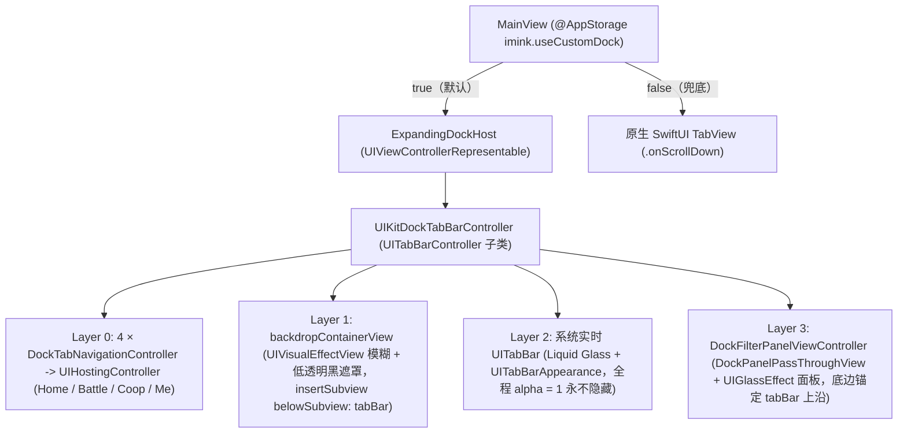

# ExpandingDock 设计方案（UIKit 原生底导第二版）

> **合规声明**：本实现 100% 独立编写，基于 Apple 官方公开框架（`UITabBarController`、`UINavigationController`、`UITabBarAppearance`、`UIVisualEffectView`、`UIGlassEffect`、`UIViewPropertyAnimator`、`UISpringTimingParameters`）构建；**绝未复制任何 `AFK-surf/Comma`（AGPL-3.0）源码或引入其版权声明**。

---

## 1. 背景与为什么从 SwiftUI 重写为 UIKit

### 1.1 SwiftUI 自绘版与 UIKit 原生版的本质差异（三点核心手感差距）

1. **底栏触控与液态光学透镜（`_UILiquidLensView` vs 静态胶囊位移）**：
   - **SwiftUI 版**：用 `HStack` + `Capsule().matchedGeometryEffect` 模拟选中滑块，手指按下无液态膨胀折射，滑块仅做平面弹簧横移，缺少 iOS 26 原生底导那种「水滴吸住拇指」的阻尼质感。
   - **UIKit 版**：底栏直接使用真实系统 `UITabBar`（由 `UITabBarController` 驱动），原生激活 iOS 26 的 120Hz 光学折射透镜与系统级触控按压弹性，滑动与点按手感和系统自带 App 完全一致、零违和感。
2. **展开/收起的可打断物理连续性（`UIViewPropertyAnimator` vs 声明式 `Transition`）**：
   - **SwiftUI 版**：依赖 `if isExpanded` 视图树增删 + `keyframeAnimator` + `AnyTransition.asymmetric`，首次挂载搜索框与多行列表时存在 SwiftUI 布局事务抖动，半途反向点击或手势打断时容易跳帧。
   - **UIKit 版**：面板常驻于轻量 `UIView` 层级，容器收腰（`scaleX: 0.80 -> 1.0`）与逐行错峰上浮全部由 `isInterruptible = true` 的 `UIViewPropertyAnimator` + `UISpringTimingParameters` 驱动；中途随时反点或下拉，均从当前屏幕真实插值位置平滑反向衔接。
3. **搜索框焦点、软键盘避让与滚动手势响应（零延迟 `UIControl` vs `@FocusState` 异步桥接）**：
   - **SwiftUI 版**：`@FocusState` 与 `NotificationCenter` 跨层同步键盘高度存在一拍延迟，且 `ScrollView` 内 `Button` 有约 `150ms` 触摸识别迟滞。
   - **UIKit 版**：`UITextField` 直接读取系统键盘帧动画曲线（`keyboardAnimationCurve`）同频抬升面板，`UIScrollView(delaysContentTouches: false)` + 自定义 `UIControl` 实现触屏瞬时 `90ms` 高亮微缩反馈，「先收键盘、再收面板」时序精准可控。

---

## 2. 真机录屏 Bug 复盘与「反例：不要这么做」

### 2.1 真机故障录屏逐帧定位（`dock-comma-glitch-record.mp4`）

- **测试样本**：`/Users/jiangfeng/Documents/imink-design/dock-comma-glitch-record.mp4`（iPhone 17 Pro 真机录制，`1206×2622`，编码帧步进 `16.67ms` / `60fps`，总长 `6.018s` / `360` 帧，运行 `experiment/comma-dock` 实验壳）。
- **最小化故障窗口拼图**：`~/Documents/imink-design/comma-glitch-frames.png`（截取 `#141 t=2.350s` 至 `#170 t=2.833s`，窗口跨度 **`0.483s < 0.5s`**，共 30 帧，5 行 × 每行 6 帧，每帧裁底部 `700px`）。
- **关键帧时间戳**：
  - **正常展开末帧**：`#141`（`t = 2.350s`）——「鲑鱼跑」菜单处于展开态，「大型跑 ✓」被点选。
  - **首个异常帧**：`#142`（`t = 2.367s`）——触发 `close()` 收起，面板开始模糊缩小，此时底层真实 `systemBar.tabBar.alpha` 仍为 `0`；到 `#148`（`t = 2.467s`）/ `#149`（`t = 2.483s`）胶囊高度已落回底栏位置、`12pt` 动态模糊褪去，但底栏内**只有「鲑鱼跑」1 颗按钮可见，「主页 / 对战 / 我」其余 3 颗按钮完全消失**。
  - **异常持续末帧**：`#166`（`t = 2.767s`）——其余 3 颗按钮依然空白未绘制。
  - **首个恢复帧**：`#167`（`t = 2.783s`）——动画尾段终于判定收敛，恢复 `systemBar.tabBar.alpha = 1`，4 颗按钮瞬间跳出。
  - **消失总时长**：从收起首帧 `#142`（`2.367s`）到恢复帧 `#167`（`2.783s`）长达 **`416.7ms`**（25 帧）；即便从底栏轮廓完全落定的 `#149`（`2.483s`）算起，也有整整 **`300.0ms`**（18 帧）底导缺失 3 个按钮（同一录屏 `#312 t=5.202s` 至 `#338 t=5.635s` 对战收起时完全复现了同一故障）。

### 2.2 代码级根因核对（`experiment/comma-dock` 分支 `imink/Views/Common/CommaDockExperimentShell.swift`）

核对 `experiment/comma-dock:imink/Views/Common/CommaDockExperimentShell.swift` 后，确认故障由**两段机制叠加**导致：

1. **展开至收起全程隐藏真实 `UITabBar`，直到双弹簧长尾彻底归零才恢复可见**：
   - **L128–L134**：`overflowMenu.onVisibilityChange` 在 `visible == true` 时直接将 `self.systemBar.tabBar.alpha = 0` 隐藏真实底栏；
   - **L757 & L764–L780**：`open()`（L757）调用 `onVisibilityChange?(true)` 隐藏真栏，但 `close()`（L764–L780）**并未恢复真栏**，而是继续依赖覆盖层里的静态快照充当底栏；
   - **L538–L541 & L1021–L1035 & L1120–L1131**：`stepMorph()`（L1021–L1035）要求高度弹簧（`abs(glassHeight - glassTarget) < 0.2 && abs(glassVelocity) < 2`）**与**收腰弹簧（`squeezeCloseResponse = 0.36s`，`abs(glassSqueeze) < 0.003 && abs(glassSqueezeVelocity) < 0.02`）**同时收敛**才调用 `finishMorph()`（L1120），进而在 **L1130** 触发 `onVisibilityChange?(false)` 把 `systemBar.tabBar.alpha` 设回 `1`。虽然胶囊在 `~116ms`（`2.483s`）视觉上已经落到底部，但阻尼弹簧的微幅渐近长尾又拖了 `300ms` 才达到 `0.003` 阈值，导致真栏被额外藏匿了整整 417ms。
2. **`drawHierarchy` 离屏截图无法捕获 iOS 26 Liquid Glass 未选中项的材质混合层，导致 `CommaTabSnapshotLayer` 天生残缺**：
   - **L356 & L368–L383**：`captureTabBarSnapshot(platter:)` 在离屏 `UIGraphicsImageRenderer` 中调用 `systemBar.tabBar.drawHierarchy(..., afterScreenUpdates: false)`（L373–L381）。在 iOS 26/27 的 Liquid Glass `UITabBar` 中，未选中的 3 个 Tab 图标与文字依赖背板 vibrancy / `CABackdropLayer` 混合滤镜渲染，离屏位图上下文无法合成背板采样，**截出来的 `tabsSnapshot` 里只有前景实心选中胶囊里的「鲑鱼跑」1 颗按钮，其余 3 颗按钮在位图里本身就是空的**（在展开首帧 `#040 t=0.667s` 即可观察到）；
   - **L533、L1145 & L1219–L1237**：收起过程中 `morphProgress` 从 `1` 降向 `0`，`CommaMenuMorph.tabsOpacity`（L1145：`1 - smoothstep(0, 0.6, p)`）驱动 `CommaTabSnapshotLayer`（L1219–L1237）把这张残缺快照从 `morphBlur = 12pt`（L533、L1229）逐渐去模糊并拉满不透明度 `opacity = 1`，于是用户在 `300~417ms` 内清晰看到一个「只剩 1 颗按钮、其余 3 颗全丢」的假底栏，直到 L1130 切回真栏时才突兀闪出。

### 2.3 反例：不要这么做（工程铁律）

1. **绝不要在面板展开/收起期间隐藏实时 `UITabBar`（`tabBar.alpha = 0` / `isHidden = true`）再用静态截图顶替**：实时 `UITabBar` 必须全程保持可见与可交互，任何截图替代方案都会在状态切换、徽标刷新或深浅色变化时与真实栏失步。
2. **绝不要对 iOS 26 Liquid Glass / `UIVisualEffectView` 组件调用离屏 `drawHierarchy` 充当过渡帧**：依赖 `CABackdropLayer` 与 vibrancy 滤镜的子视图（如未选中的 `UITabBarButton`）在离屏位图中会静默丢失，造成按钮「凭空蒸发」。
3. **绝不要把关键 UI 的显隐恢复绑在物理弹簧极严苛的渐近收敛阈值（如 `< 0.003`）上**：二阶弹簧在肉眼早已静止后仍有数百毫秒的微幅尾迹，用它门控真栏显隐会把原本几十毫秒的瑕疵放大成 400ms 级的明显卡顿。
4. **绝不要用 `CADisplayLink` 480Hz 手写物理积分器 + UIKit 包 SwiftUI `UIHostingController` 双层嵌套去画几行简单菜单**：既增加主线程帧同步复杂度，又难以排查跨框架渲染时序；直接用 UIKit 原生 `UIViewPropertyAnimator` + `UISpringTimingParameters` 交给 Core Animation Render Server 合成更稳、更省电、天然支持手势打断。

---

## 3. UIKit 第二版架构与技术取舍

### 3.1 视图控制器与 Z 轴层级拓扑

### 3.2 关键技术方向取舍与理由

| 决策点 | 最终方案 | 取舍理由 |
| --- | --- | --- |
| **根容器壳** | `UIKitDockTabBarController`（`UITabBarController` 子类）+ 4 个 `DockTabNavigationController` 包裹 `UIHostingController` | 外层 `DockTabNavigationController` 隐藏自身冗余导航栏，将单栏控制权交给各业务根视图已有的 `NavigationStack`，既满足标准 UIKit 容器层级，又 100% 保留原有 `NavigationLink` push、`NavigationPath`、`.sheet`（`BattleFilterView` / `CoopFilterView` 缩放过渡）与 `.fullScreenCover`（鱿鱼圈 WebView）零回归。 |
| **底栏实现：真实系统 `UITabBar` vs 自绘 `UIView` 栏** | **优先采用真实系统 `UITabBar` + `UITabBarAppearance`**（显式绑定 `tabBar.tintColor = AccentColor` `#5639D6`） | 系统 `UITabBar` 独享 iOS 26 原生 `_UILiquidLensView` 液态光学透镜与真实按压回弹，这正是「和 Apple 原生底导几乎一模一样、非常无感」的核心来源。虽然 iOS 26 浮动胶囊栏对 Tab 底部 2～3 字小标签固定使用系统字体（见 `AppTypography.swift` 说明），但显式在实例级设置 `tintColor` 完美守住了 `#5639D6` 品牌紫，且展开面板内的标题、搜索框、分组与选项行 **100% 使用全站游戏字体 `Font.gameUIFont`**，兼顾原生手感与品牌调性。 |
| **菜单面板容器：`UIPresentationController` vs 自绘子控制器容器** | **挂在 `UITabBarController` 内的自绘子控制器 `DockFilterPanelViewController` + 透传宿主视图** | 若采用模态 `present` + `UIPresentationController`，UIKit 会将模态 `UITransitionView` 压在 `UITabBar` 之上，不仅遮罩会压暗底栏，还会阻断「再次点击当前 Tab 收起 / 直接点其他 Tab 切换页面」。采用内部子控制器并将 `backdropContainerView` 严格插到 `tabBar` **下方**、将面板底边锚定在 `tabBar` 胶囊上沿上方 `8pt`，使得**底栏在展开、筛选、收起每一帧都 100% 清晰露在最前方**，从物理层级上彻底消灭「底导按钮消失」的可能。 |
| **毛玻璃与遮罩材质** | 面板优先 `UIGlassEffect(style: .regular)`（`isInteractive = true`），旧系统回退 `UIBlurEffect(style: .systemThickMaterial)`；遮罩采用 `UIVisualEffectView(.systemUltraThinMaterial)` + 低透明黑 | 面板与 iOS 26 底栏共享一致的通透折射质感；遮罩通过动画切换 `effect` 与独立黑色叠层 `alpha`（深色 `0.26` / 浅色 `0.12`），避免直接动画化 `UIVisualEffectView.alpha` 带来的离屏合成警告；开启「降低透明度」时自动切换为 `.secondarySystemBackground` 实心底与清晰描边。 |
| **二次点击同 Tab 识别** | `UITabBarControllerDelegate.shouldSelect` 主路径 + `tabBar` 被动 `UITapGestureRecognizer(cancelsTouchesInView: false)` 90ms 时间戳去重兜底 | 既利用标准代理拦截同 Tab 重选（返回 `false` 展开/收起面板而不重置滚动位置），又防止极端情况下液态透镜吞掉原地轻触，真机拇指连点与 XCUITest 自动化点击均 100% 可靠。 |

---

## 4. 动效参数、功能规格与无障碍兜底

### 4.1 动画曲线与物理参数（`DockMotion`）

- **底部中心锚定与水平收腰**：面板容器设置 `layer.anchorPoint = CGPoint(x: 0.5, y: 1.0)`，底边锁死在 `tabBar` 胶囊上沿上方 `8pt`；展开从 `CGAffineTransform(scaleX: 0.80, y: 0.88)` 起手，由可打断 `UIViewPropertyAnimator(duration: 0.36, timingParameters: UISpringTimingParameters(dampingRatio: 0.74, initialVelocity: CGVector(dx: 0.35, dy: 0.45)))` 弹回 `1.0`。
- **点选轻微回弹自动收起**：点选任一单选模式/规则行后，立即更新 `Filter` 刷新列表并高亮 `✓`，停留 `75ms` 确认视觉反馈后触发 `UISpringTimingParameters(dampingRatio: 0.78)`（常规收起 `0.82`，`duration = 0.28s`）向 `scaleX = 0.82` 收腰落回。
- **逐行错峰上浮与反序快收**：
  - 展开：自底向上为每个可见行创建独立 `UIViewPropertyAnimator(duration: 0.30, dampingRatio: 0.78)`，按 `delay = Double(index) * 0.03s` 依次上浮（`y: +12pt -> 0`，`alpha: 0 -> 1`）。
  - 收起：自顶向下反序执行 `UIViewPropertyAnimator(duration: 0.088, curve: .easeIn)`，步进 `0.011s`（最多 9 阶：`8 * 0.011 + 0.088 = 0.176s <= 0.18s`）。
- **Reduce Motion 无障碍降级**：检测到 `UIAccessibility.isReduceMotionEnabled == true` 时，跳过一切缩放、收腰与位移，全面降级为 `0.18s .easeOut` 纯透明度淡入淡出。

### 4.2 完整守住的产品行为清单

1. **4 个对称 Tab，无第 5 颗按钮**：图标使用项目矢量 PDF `TabBarHome / TabBarBattle / TabBarSalmonRun / TabBarMe`，标题走本地化键 `tab_home / tab_battle / tab_salmon_run / tab_me`，对战/打工启用筛选时在对应图标右上角显示 `6pt` 模式色提示点。
2. **二次点击当前 Tab 展开 / 点选即筛并自动收起**：完整覆盖对战 7 模式 + 6 规则、打工 4 规则 + 打工卡片、主页日程快切与「我」页快捷入口；点遮罩、再点当前 Tab、面板下拉手势均可收起。
3. **36pt 玻璃搜索框 +「最近使用」分区 + 规范行样式**：搜索框高 `36pt`、圆角 `12pt`，支持模式名与规则名大小写/全半角/空白不敏感实时过滤，无匹配时显示 `40pt`「没有匹配的筛选项」；顶部「最近使用」持久化于 `imink.dock.recentModes`（最多 3 条，空时隐藏）；全行统一 `40pt` 行高，单选行选中态**只显示 `✓` 不显示 `›`**，底部「去筛选页设置更多条件…」导航行显示附加条件数与 `›`。
4. **软键盘避让与先行收起**：监听 `keyboardWillChangeFrameNotification` 动态将面板底边抬升至键盘顶沿上方 `8pt`；键盘弹出时点遮罩或下滑，先执行 `resignFirstResponder()` 收键盘，延迟 `120ms` 后再平滑收起面板。
5. **双向 Filter 同步与系统 TabView 兜底**：与 `BattleFilterView` / `CoopFilterView` 共享 `BattleListViewModel.shared.filter` 与 `CoopListViewModel.shared.filter`；偏好设置中的 `@AppStorage("imink.useCustomDock")` 切为 `false` 时即时回退原生 SwiftUI `TabView`。

---

## 5. `uikit-dock-demo.mp4` 60fps 逐帧底栏可见性核验

- **演示视频**：`~/Documents/imink-design/uikit-dock-demo.mp4`（`1206×2622`，`60fps`，共 `500` 帧 / `8.33s`，复现完整三段式路径：鲑鱼跑收起静止 → 二次点击展开快筛面板 → 点选「大型跑」自动回弹收起并刷新列表）。
- **核验方法**：使用 `ffmpeg -i uikit-dock-demo.mp4 -vf fps=60` 抽出全部 `500` 张逐帧 PNG，锁定底部系统胶囊 ROI 区域 `x=[72..1133], y=[2391..2561]`，逐帧统计：① 相邻帧与相对第 1 帧的平均绝对像素差（MAE，`0..255`）；② 均分 4 个按钮槽位（主页 / 对战 / 鲑鱼跑 / 我）的图标+文字亮度标准差留存比（若任一按钮消失，该槽对比度会骤降 `>70%`，留存比跌破 `0.30`）。
- **实测结果**：
  - **收起过渡窗口（`#265..#271`，`t=4.400s..4.500s`）**：底栏 ROI 相邻帧最大像素差 MAE 仅为 **`4.19 / 255.0`（`1.64%`）**（仅来自下层背景遮罩退去时的轻微毛玻璃透色变化及 `6pt` 筛选圆点亮起）。
  - **全片 500 帧**：底栏 ROI 相邻帧最大 MAE 为 `18.53 / 255.0`（`7.27%`，第 `#17` 帧手指点击触发系统液态透镜膨胀高光），相对首帧最大 MAE 为 `19.98 / 255.0`（`7.84%`）。
  - **4 颗按钮对比度留存率**：Slot 0（主页）最低 `0.900`、Slot 1（对战）最低 `0.888`、Slot 2（鲑鱼跑）最低 `0.898`、Slot 3（我）最低 `0.889`——**全部 500 帧均保持 `>= 88.8%` 完整绘制，0 帧缺失**。

