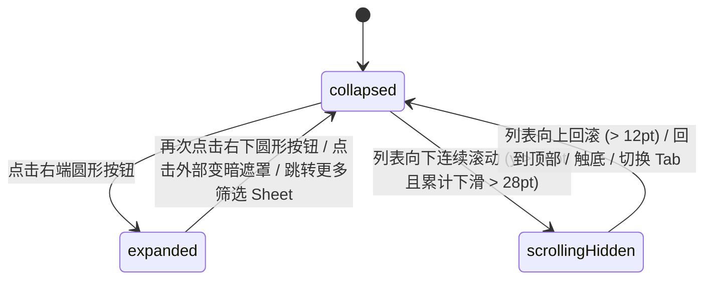

# ExpandingDock 设计方案（imink 第一版）

## 1. 背景与「低改动高收益」架构拆分

### 1.1 为什么必须换掉系统浮动胶囊栏
iOS 26/27 的系统浮动胶囊 `TabView` 完全接管了底部标签栏绘制：`UITabBarItem`、`UITabBarAppearance` 与 `Tab` 自定义 `Label` 内的 `.font(...)` 均被系统忽略，且一旦构造新的 `UITabBarAppearance` 还会把全局 `AccentColor`（`#5639D6`）重置为系统蓝（详见 `Shared/Modifiers/AppTypography.swift` 顶部注释）。只有自绘底栏表面，才能拿回**全站游戏字体**（简中 `DFPZongYiW7` / 繁中 `DFP222` / 日文 `KurokaneStd-EB` / 韩文 `KoreanERIN-M` / 英文 `Splatfont 1`）、**`<= 49pt` 的轻薄高度**、圆角以及向上展开面板的控制权。

### 1.2 哪些用系统能力兜住 vs 哪些必须自绘（最小侵入原则）

为避免推倒重做整套根导航容器，我们采用**保留原生 `TabView` 容器 + 仅隐藏系统栏外观 + 叠放自绘 `ExpandingDock`** 的低改动高收益路径：

| 职责模块 | 实现归属 | 说明 |
| --- | --- | --- |
| **4 个根页面生命周期、懒加载与 `NavigationStack` 状态保持** | **系统能力兜住**（保留 `MainView` 原有 `TabView(selection: $tabSelection)`） | 不拆 `TabView`，通过 `.toolbar(useCustomDock ? .hidden : .visible, for: .tabBar)` 仅隐藏系统 `UITabBar` 视觉层；Tab 切换、状态保活、`.sheet` / `.fullScreenCover` 模态层级全部继续由系统托管。 |
| **兜底回退（`@AppStorage("imink.useCustomDock")`）** | **系统能力兜住** | 开关默认 `true`；切为 `false` 时恢复 `.toolbar(.visible, for: .tabBar)` 与 `.tabBarMinimizeBehavior(.onScrollDown)`，原系统 `TabView` 与顶部标题菜单零损可用。 |
| **完整多维筛选抽屉（`BattleFilterView` / `CoopFilterView`）** | **现有页面复用** | 继续使用原生 `.sheet` 承载场地、武器、时间滑杆、工友搜索、收藏/删除状态等重筛选，与 Dock 共用同一个 ViewModel 的 `@Published var filter: Filter`。 |
| **底栏胶囊 + 右侧独立圆钮 + 向上展开模式快筛面板** | **必须自绘**（`ExpandingDock.swift`） | SwiftUI 原生 `TabView` 不支持将胶囊向上变形为自定义筛选行卡片，也不支持注入游戏字体；自绘约 380 行纯 SwiftUI 组件即可完整实现。 |
| **列表滚动自动退让与底部净空补齐** | **轻量适配**（`FloatingBarInsets.swift`） | 用 SwiftUI 原生 `.onScrollGeometryChange` 被动感知列表滚动方向，不挂额外手势；`FloatingBarInsets` 按新 Dock 实测顶沿（`68pt`）补齐 `8pt` 透明呼吸净空。 |

---

## 2. 参考实现的思路（未复制代码）

> **合规声明**：本节仅阅读并提炼架构与交互思路，**未复制任何源码，亦未引入任何第三方或 AGPL 代码与许可证文件**；所有代码均为针对 imink 业务与 SwiftUI 体系独立编写。

### 2.1 从 `afk-surf/comma` 学到的核心机制（仅借鉴思路，未复制代码）

精读了原视频对应的开源客户端 `afk-surf/comma` 中 `ShellTabBarController.swift`、`Design/Glass/GlassTabBar.swift`（`TabOverflowMenuView`）与 `Tasks/Dock/TaskDockViewController+Interaction.swift`，对照原视频逐帧图（`f001`～`f040`），提炼出 4 条关键机制：

1. **「左主胶囊 + 右独立圆钮」双体并列拓扑与底边锚定生长**：
   - 视频帧（`f001`、`f009`、`f014`、`f016`）与 `GlassTabBar.swift` 显示，底栏并非单一大长条，而是**左侧主胶囊 + `8~10pt` 间距 + 右侧等高独立正圆按钮**。
   - 展开时，左侧主胶囊**以底边 `maxY` 为不动锚点向上生长**为圆角卡片面板（`CGRect(x: bar.minX, y: bar.maxY - height, ...)`），右侧圆形按钮稳稳停留在原位（视觉上正好处于展开卡片的右下侧），再次点击该圆钮或点击外部遮罩即可原路折回胶囊，拇指无需移动位置。
2. **半高连续圆角（`thickness / 2`）与紧凑行高节奏**：
   - `TabOverflowMenuView` 将容器圆角固定为收起态厚度的一半（`.continuous` 连续曲率），使收起态天然是标准胶囊，展开态无需跳变圆角半径即可平滑过渡为大圆角面板；内部行高 `44~48pt`、外圈内边距 `8pt`，选中行带内嵌胶囊底块高亮。
3. **弹簧开合与逐行上浮微动效 + Reduce Motion 降级**：
   - 展开采用带轻微回弹的弹簧（时长约 `0.35s`、阻尼约 `0.72~0.78`），面板行带约 `10~14pt` 的自下而上微位移与淡入；收起采用更高阻尼（`~0.85+`）干脆落位，防止底边回弹穿模。
   - `TaskDockViewController+Interaction.swift` 显式检测 `UIAccessibility.isReduceMotionEnabled`，开启时放弃弹簧位移，降级为短促（`0.15~0.20s`）的 `.easeOut` 透明度过渡。
4. **手势隔离与滚动共存原则**：
   - 外部点击关闭手势仅在面板展开（`isOpen == true`）且触点落在面板 `frame` 之外时接收事件；收起态下容器空白区完全透传触摸，且绝不在 `UIScrollView` 内容区抢占纵向滚动手势；展开期间开启模态无障碍标记（`accessibilityViewIsModal`），收起瞬间立即释放。

#### 我们的实现为什么与 `afk-surf/comma` 截然不同

| 维度 | `afk-surf/comma`（原项目） | `imink`（我们的独立实现） |
| --- | --- | --- |
| **技术栈与复杂度** | 重度 UIKit：`ShellTabBarController`（1,200+ 行 `UITabBarController` 子类）+ `TabOverflowMenuView`（3,300+ 行基于 `CADisplayLink` 逐帧手算物理量的 `UIView`），目的是在静止态复用系统 `_UILiquidLensView` 并在折叠屏侧栏等 5 种姿态间做像素级接管。 | 纯声明式 SwiftUI（约 380 行）：保留 SwiftUI `TabView` 隐藏系统栏，叠加 `ExpandingDock` 视图，直接用 SwiftUI `spring` 动画、`.ultraThinMaterial` 与 `@Namespace` `matchedGeometryEffect`，零 `CADisplayLink`、零视图树遍历黑魔法。 |
| **底栏排版诉求** | 系统 SF Symbols 无文字图标栏（`home` / `inbox` / `people` + `more`）。 | 必须渲染 imink 专属 PDF 矢量图标（`TabBarHome` 等）+ **多语种游戏字体 11pt 标签**，且总高度压薄至 **`48pt`**（`<= 49pt`）。 |
| **主胶囊与右圆钮语义** | 左胶囊第 4 槽溢出二级导航页（`Apps` / `Drive` / `Plugins` / `Settings`），右圆钮打开 AI 对话路由层。 | 左胶囊完整承载 **4 个一级 Tab（主页 / 对战 / 鲑鱼跑 / 我）**；**右圆钮专职作为当前 Tab 的「模式快筛展开键」**，展开卡片承载数据库真实模式枚举与「去筛选页设置更多条件…」。 |

### 2.2 SwiftUI 社区近似实现对比（`mikonyaa/LiquidGlassTabBars`）

同时调研了社区纯 SwiftUI 实现 `mikonyaa/LiquidGlassTabBars`（`LiquidTabBar.swift` 与 `LiquidGlassSurfaceModifier.swift`）：

- **对方做法**：使用 `@Namespace` + `matchedGeometryEffect(id:in:)` 驱动选中胶囊在 Tab 间平滑横移（`.spring(response: 0.32, dampingFraction: 0.82)`）；通过 `LiquidGlassSurfaceModifier` 同时监听 `@Environment(\.accessibilityReduceMotion)` 与 `@Environment(\.accessibilityReduceTransparency)`（开启「降低透明度」时自动退化为实心底色 + `1pt` 描边）；支持重复点击当前 Tab 触发 `onReselect`。
- **我们借用的思路**：① 用 `@Namespace` + `matchedGeometryEffect` 实现 4 个 Tab 间的选中胶囊横移；② 同时尊重 `Reduce Motion` 与 `Reduce Transparency` 两项系统无障碍设置。
- **为什么不能直接引入该第三方依赖**：
  1. **缺少核心交互**：它只有水平胶囊切换，没有「右侧独立圆形按钮」与「向上弹开成筛选行列表面板」的状态机；
  2. **尺寸与字体不符**：其默认栏高 `60pt` 超过我们 `<= 49pt` 的硬指标，且写死了 `Image(systemName:)` 与系统 `.caption2` 字体，无法直接渲染 imink 矢量资源与游戏字体；
  3. **依赖与维护成本**：为百余行 UI 表层引入外部 SPM 包会增加构建供应链、Xcode 版本兼容与许可证审计负担，原生自写更轻、更可控。

---

## 3. 状态机设计（`DockState`）

| 状态 | 触发条件 | 视觉与交互表现 |
| --- | --- | --- |
| `collapsed`（收起常驻态） | 默认初始态；面板关闭后；列表在顶部（`y <= 24pt`）、向上回滚或滚到底部（距底 `<= 36pt`） | 左为 **4-Tab 轻薄胶囊（`48pt` 高）**，右隔 `10pt` 为 **`48×48pt` 圆形展开按钮**；若当前 Tab 有生效筛选条件，圆钮右上角浮现模式色圆点角标。 |
| `expanded`（面板展开态） | 点击右端圆形按钮 | 全屏浮现变暗虚化遮罩；左侧胶囊沿底边向上弹开成毛玻璃圆角面板，展示当前 Tab 模式筛选行 + 底部「去筛选页设置更多条件… `›`」；右下圆钮图标旋转为 `xmark`。点击任一模式行**立即同步 `Filter` 并重筛列表**（面板保持展开方便确认勾选态）；点遮罩或再点右下圆钮收回成胶囊。 |
| `scrollingHidden`（滚动退让态） | 非展开态下，列表 `y > 96pt`、未触底且连续下滑 `> 28pt` | 像 iOS 26 一样自动退让：整组 Dock 向屏幕下方轻移并淡出（`offsetY: +68pt, scale: 0.94, opacity: 0`，关闭点击热区）；稍向上滑 `> 12pt` 或滑到底部立即回弹恢复 `collapsed`。滚动容器底部 `safeAreaInset` 保持恒定 `76pt` 不跳变。 |

---

## 4. 各状态尺寸、圆角、材质与阴影常量（4pt 栅格）

### 4.1 几何尺寸常量（`DockMetrics`）

| 常量项 | 数值 | 设计说明 |
| --- | --- | --- |
| `collapsedHeight` | **`48pt`** | 严格 `<= 49pt`（比 iOS 26 系统浮动栏 `62pt` 薄 `14pt`），契合全站 `4pt` 栅格且满足 Apple HIG `>= 44pt` 触控高度 |
| `circleButtonSize` | **`48×48pt`** | 与左侧收起胶囊等高对齐，间距 `dockSpacing = 10pt` |
| `cornerRadius` | **`24pt`**（`.continuous`） | `collapsedHeight / 2`，收起时为标准胶囊，展开时同源过渡为 `24pt` 连续曲率卡片 |
| `tabPillHeight` / `tabPillInset` | **`40pt`** / **`4pt`** | 内部选中滑块圆角 `20pt`（`24 - 4 = 20` 同心圆角）；图标 `18×18pt` + `11pt` 游戏字体单行文案 |
| `panelRowHeight` | **`44pt`** | 展开面板单行高度（内圆角 `12pt`），左侧 `28×28pt` 模式色图标块 + `15pt` 游戏字体模式名 + 右侧勾选标与 `›` chevron |
| `expandedMaxHeight` | **`min(屏幕高 * 0.62, 428pt)`** | 对战（7 行模式 + 1 行更多条件 + 标题栏）完整展开约 **`396pt`**，打工（5 行 + 1 行更多条件 + 标题栏）约 **`312pt`**；小屏/横屏超出自动内滚 |
| `horizontalMargin` / `maxDockWidth` | **`16pt`** / **`392pt`** | 手机竖屏左右各留 `16pt`；iPad 或横屏总宽封顶 `392pt` 居中悬浮 |
| `bottomMargin` | Face ID 机型 **`20pt`**（`max(safeArea.bottom - 14, 16)`）；无安全区机型 **`12pt`** | 精准悬停在 Home Indicator 上方，不压系统手势条 |
| `tabBarTopFromScreenBottom` | Face ID 机型 **`68pt`**（`20 + 48`） | 实测值同步写入 `FloatingBarInsets.measuredCustomDockTop` / `measuredTabBarTop`，加上 `breathingSpacing = 8pt` 后列表底部总净空 **`76pt`** |

### 4.2 材质与阴影

- **毛玻璃材质**：主体采用 `.ultraThinMaterial`，叠加浅/深色微调衬底（浅色叠 `Color.white.opacity(0.58)` 提亮防脏，深色叠 `Color(red: 0.08, green: 0.09, blue: 0.12).opacity(0.68)` 塑造深色半透明卡片感；若系统开启「降低透明度」则自动切换为不透明 `Color.listItemBackground`），外圈配 `1pt` 顶部高光渐变描边。
- **展开背景遮罩**：`Color.black.opacity(colorScheme == .dark ? 0.54 : 0.36)` 全屏淡入，点击即收起。
- **阴影**：
  - `collapsed`：`Color.black.opacity(colorScheme == .dark ? 0.38 : 0.14), radius: 14, x: 0, y: 6`
  - `expanded`：`Color.black.opacity(colorScheme == .dark ? 0.50 : 0.24), radius: 24, x: 0, y: 10`

---

## 5. 动画参数与手感取舍

- **面板展开 / 收起主动画**：`.spring(response: 0.36, dampingFraction: 0.78, blendDuration: 0.08)`（严格落在目标区间 `response: 0.34~0.42, dampingFraction: 0.72~0.82` 中点）。
  - **锚点与缩放**：展开面板附加 `.scaleEffect(isExpanded ? 1.0 : 0.94, anchor: .bottom)` 与 `.opacity` 过渡，使卡片有从底部胶囊向上轻弹张开的物理体积感，且底边 `maxY` 稳固不漂移。
  - **取舍理由**：`0.36s` 响应迅速不拖沓；`0.78` 阻尼产生一次恰到好处的轻回弹，既呼应参考视频里轻盈灵动的弹性，又避免低阻尼果冻晃动导致文字难以第一时间阅读。
- **Tab 选中滑块动画**：`.spring(response: 0.34, dampingFraction: 0.80)`，连点切换四个 Tab 时干脆跟手。
- **滚动退让动画**：`.spring(response: 0.38, dampingFraction: 0.82)`，临界点平稳不闪烁。
- **无障碍减弱动态效果（`UIAccessibility.isReduceMotionEnabled`）**：统一通过 `DockMotion.animation(...)` 检测 `UIAccessibility.isReduceMotionEnabled || reduceMotion`；一旦开启，**全部退化为 `.easeOut(duration: 0.2)`**，同时关闭 `scaleEffect`（恒为 `1.0`）与图标旋转位移。

---

## 6. 模式筛选进 Dock 后的信息架构与真实枚举覆盖

经核查 `Shared/Models/BattleMode.swift`、`Shared/Models/CoopRule.swift`、`Shared/Data/RecordListQueries.swift` 以及本地真实种子库 `seed-db.sqlite`（`SELECT DISTINCT mode FROM battle` 与 `SELECT DISTINCT rule FROM coop`）：

### 6.1 面板内快筛枚举（真实数据库定义）

1. **对战 Tab（Tab 1，`BattleMode`，查询列 `battle.mode`）**：
   - `BattleMode.all`（`"ALL"` → **全部对战**，对应 `filter.modes = []`）
   - `BattleMode.regular`（`"REGULAR"` → **一般比赛** / 占地涂地）
   - `BattleMode.anarchy`（`"BANKARA"` → **蛮颓比赛** / 真格系列）
   - `BattleMode.xMatch`（`"XMATCH"` → **X比赛**）
   - `BattleMode.league`（`"LEAGUE"` → **活动比赛**）
   - `BattleMode.privateMatch`（`"PRIVATE"` → **私人比赛**）
   - `BattleMode.fest`（`"FEST"` → **祭典比赛**）
   - 底部固定入口：**「去筛选页设置更多条件…」**（右侧带剩余激活条件计数与 `›` chevron，点击收起 Dock 并弹出 `BattleFilterView`）。
2. **鲑鱼跑 Tab（Tab 2，`CoopRule`，查询列 `coop.rule`）**：
   - `CoopRule.ALL`（`"ALL_RULE"` → **全部打工**，对应 `filter.rules = []`）
   - `CoopRule.REGULAR`（`"REGULAR"` → **鲑鱼跑**）
   - `CoopRule.BIG_RUN`（`"BIG_RUN"` → **大型跑**）
   - `CoopRule.TEAM_CONTEST`（`"TEAM_CONTEST"` → **团队打工竞赛**）
   - 视图切换行：**打工卡片**（调用 `loadCards()` 按班次聚合浏览，对齐原顶部菜单能力）
   - 底部固定入口：**「去筛选页设置更多条件…」**（右侧带场地/武器/工友/时段等已启用条件数与 `›` chevron，点击收起 Dock 并弹出 `CoopFilterView`）。
3. **主页 Tab（Tab 0）与 我 Tab（Tab 3）**：
   - 主页展开面板提供「对战日程 / 鲑鱼跑日程」快切（双向绑定 `@AppStorage("home_page_selectedScheduleType")`）以及直达对战/打工筛选入口；
   - 「我」页展开面板提供「武器榜 / 场地榜 / 记录回收站 / 偏好设置」快捷跳转行（每行带 `›` chevron），保证在任意 Tab 点开右端圆钮都有实用一致的面板体验。

### 6.2 哪些留在筛选页 Sheet + 双向同步机制

- **留在 `BattleFilterView` / `CoopFilterView` 的重条件**：多模式并集勾选（如同时看蛮颓 + X比赛）、起止日期范围双滑杆、地图多选网格、配发武器 11 大类多选、同工玩家搜索与精确匹配、活跃/已删除记录范围、只显示收藏、一键重置。
- **双向同步**：
  - Dock 与 `BattleFilterView` 共同读写 `BattleListViewModel.shared.filter`；与 `CoopFilterView` 共同读写 `CoopListViewModel.shared.filter`（`CoopFilterView` 同步补齐打工规则筛选区块与概览标签展示，确保从 Dock 选完「大型跑」进 `CoopFilterView` 能直观看到并支持重置联动）。
  - 在 Dock 点选某模式时仅修改 `filter.modes` / `filter.rules`，完整保留收藏、地图、武器等其他已选条件，同时立即刷新 `navigationTitle` 与列表数据。

---

## 7. 风险清单与应对

1. **手势冲突（横向滚动 vs 拖拽展开 vs 系统上滑回桌面）**：
   - 第一版**不绑定底部边缘上滑拖拽展开手势**，严格采用「点右端圆钮展开、点遮罩或圆钮收起」，从根源上杜绝与 iOS Home Indicator 手势、首页轮播 `CarouselView` 横滑及列表纵滑抢事件。列表滚动隐藏采用纯被动的 `onScrollGeometryChange` 监听。
2. **安全区与 `FloatingBarInsets` 留白精度**：
   - 当 `useCustomDock == true` 时，`TabView` 系统栏隐藏后子容器 `safeAreaInsets.bottom` 变为 `34pt`（仅 Home Indicator）。`FloatingBarInsets` 区分新旧模式：自定义 Dock 模式下不再被 `34pt` 误覆盖 `measuredTabBarTop`，而是按实测 Dock 顶沿 `68pt` + `8pt` 呼吸间距补齐差额 `42pt`（总净空 `76pt`）；切回旧系统栏（`useCustomDock == false`）时自动恢复 `83pt + 8pt = 91pt`。
3. **iPad 与横屏适配**：
   - 限制 Dock 总宽上限 `392pt` 居中悬浮，避免在 iPad 上拉成横跨全屏的宽条；展开面板加 `ScrollView` 最大高度保护（`min(screenHeight * 0.62, 428pt)`），横屏矮视口下可顺滑滚动不顶穿导航栏。
4. **Live Activity 与顶部 Toast 并存**：
   - 灵动岛 `LiveActivityManager` 与居顶的 `SplatoonToastOverlay` 位于屏幕顶部；`.sheet` / `.fullScreenCover` 位于系统模态层高于 `MainView`，且从 Dock 打开筛选 Sheet 时先收起面板，视觉层级互不干扰。
5. **无障碍（VoiceOver / Reduce Motion / Reduce Transparency / Dynamic Type）**：
   - 完整支持 `UIAccessibility.isReduceMotionEnabled`（`0.2s easeOut` 无缩放）与 `accessibilityReduceTransparency`（实心高对比底色）；展开态为面板标记 `.accessibilityAddTraits(.isModal)` 并隐藏背景可访问性焦点；底栏胶囊限制 `.dynamicTypeSize(...DynamicTypeSize.xLarge)` 防止超大字号撑破 `48pt` 胶囊，同时为所有按钮标注清晰的中文 `accessibilityLabel` 与选中状态。
